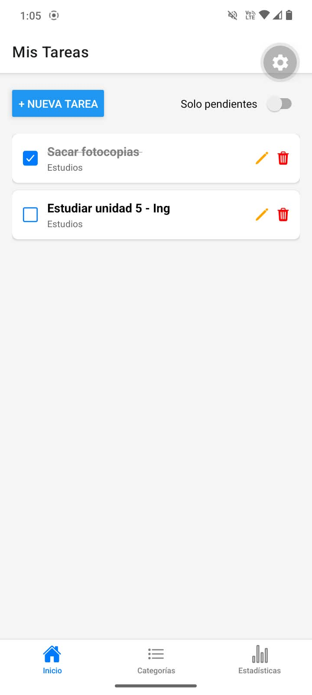
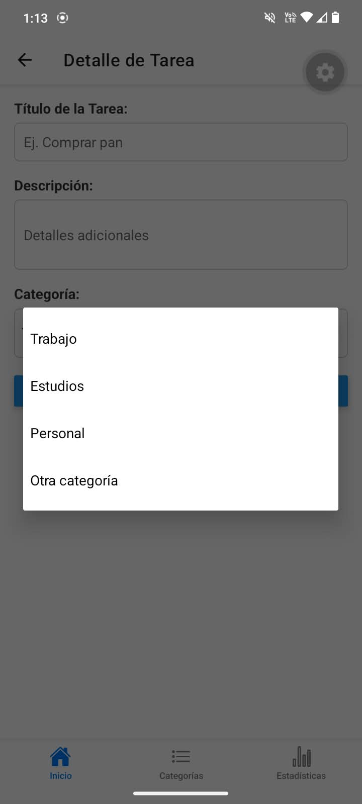
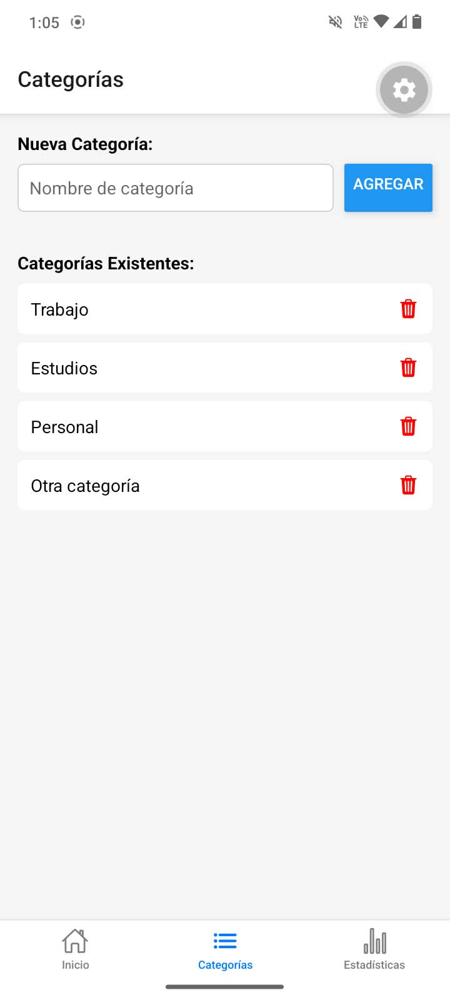
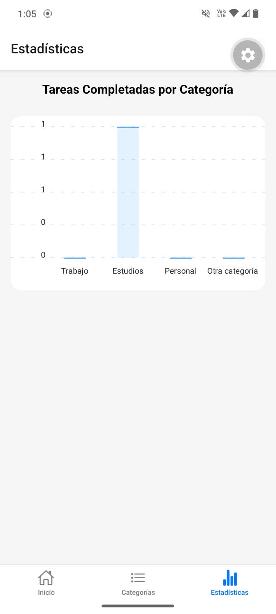

# Aplicación Agenda de Tareas

## 1. Introducción y Objetivos
Aplicación móvil y web multiplataforma desarrollada en **React Native (Expo)** utilizando **TypeScript**. Su objetivo principal es la gestión eficiente de tareas personales, permitiendo al usuario:
- Crear, editar y borrar tareas.
- Marcar tareas como realizadas o pendientes.
- Organizar las tareas mediante un sistema relacional de categorías.
- Visualizar el progreso de tareas completadas mediante un gráfico estadístico.

## 2. Arquitectura de Base de Datos Relacional (SQLite)
La persistencia de datos se diseñó para operar de forma dual (usando `expo-sqlite` en dispositivos móviles Android y `sql.js` con almacenamiento en memoria para la versión web). La base de datos relacional consta de dos tablas principales vinculadas por una clave foránea:

* **Tabla `categorias`:**
  - `id` (INTEGER, Primary Key, Auto-increment)
  - `nombre` (TEXT, Not Null)
  - `color` (TEXT)

* **Tabla `tareas`:**
  - `id` (INTEGER, Primary Key, Auto-increment)
  - `titulo` (TEXT, Not Null)
  - `descripcion` (TEXT)
  - `completada` (INTEGER, Default 0 - Representa booleano: 0 pendiente, 1 completada)
  - `categoria_id` (INTEGER, Foreign Key referenciando a `categorias(id)` con regla `ON DELETE CASCADE`)

## 3. Explicación de Componentes y Pantallas
La aplicación cuenta con una navegación por pestañas (*Bottom Tabs*) y pilas (*Stacks*) que estructuran 4 vistas principales:

1. **`HomeScreen.tsx` (Pantalla Principal / Tareas):** 
   - Renderiza un listado (`FlatList`) de las tareas obtenidas de la base de datos.
   - Permite cambiar el estado de una tarea (completada/pendiente) mediante un componente interactivo y filtrar la vista rápidamente con un interruptor (*Switch*) de "Solo pendientes".
   - Ofrece accesos directos para editar o eliminar cada tarea.

2. **`TaskFormScreen.tsx` (Formulario de Tareas):**
   - Funciona tanto para altas como para ediciones según los parámetros recibidos por navegación (`taskId`).
   - Contiene campos de texto para el título y la descripción, y un selector (`Picker`) dinámico para asignar la categoría correspondiente.

3. **`CategoriesScreen.tsx` (Gestión de Categorías):**
   - Pantalla de administración para dar de alta nuevas categorías o eliminar las existentes de forma relacional.

4. **`StatsScreen.tsx` (Panel de Estadísticas):**
   - Consulta las tareas completadas agrupándolas por categoría mediante una sentencia SQL con `COUNT` y `GROUP BY`.
   - Renderiza un gráfico de barras interactivo utilizando la librería `react-native-chart-kit`.

## 4. Capturas de Pantalla de la Aplicación Funcionando
*(Asegúrate de guardar tus capturas dentro de la carpeta `public/screenshots_app_funcionando/`)*

- **Pantalla Principal (Lista de Tareas):**
  

- **Formulario (Crear/Editar Tarea):**
  

- **Gestión de Categorías:**
  

- **Panel de Estadísticas (Gráfico de Barras):**
  

## 5. Instrucciones de Ejecución
Para poner en marcha el proyecto localmente:
1. Clonar o descomprimir el repositorio.
2. Instalar las dependencias necesarias:
   ```bash
   npm install