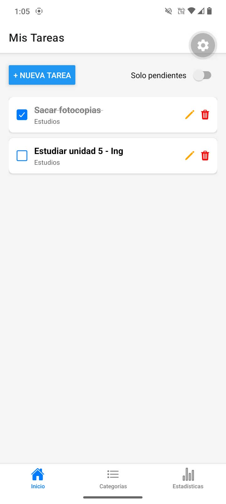
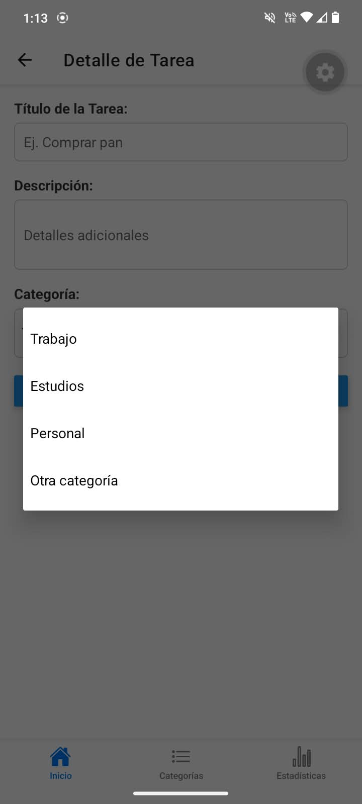
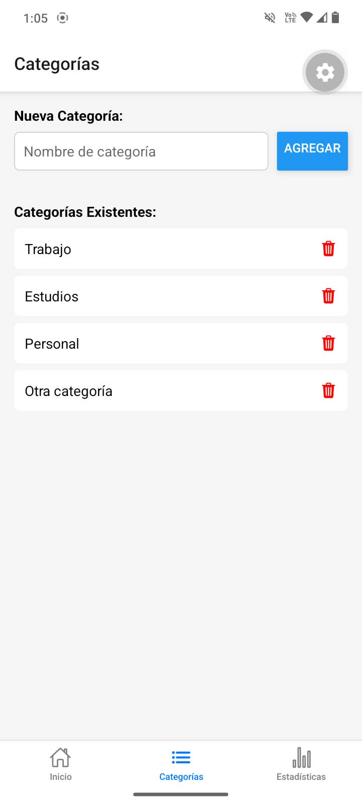
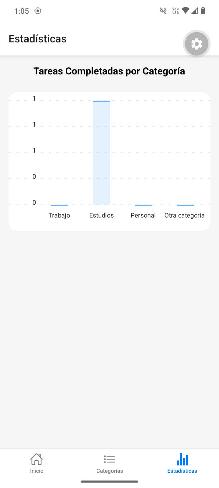

# Agenda de Tareas

Aplicación móvil y web multiplataforma desarrollada con **React Native (Expo)** y **TypeScript** para gestionar tareas personales, organizarlas por categorías y visualizar el progreso de avance.

## Funcionalidades principales
- Crear, editar y eliminar tareas.
- Marcar tareas como completadas o pendientes y filtrar rápidamente por *Solo pendientes*.
- Administrar categorías con relación directa sobre las tareas (`ON DELETE CASCADE`).
- Consultar estadísticas de tareas completadas agrupadas por categoría mediante un gráfico de barras (`react-native-chart-kit`).

## Arquitectura y persistencia (SQLite)
La aplicación utiliza una base de datos relacional con dos tablas vinculadas (`categorias` y `tareas`) y adapta la persistencia según la plataforma:
- **Móvil (Android):** `expo-sqlite`.
- **Web:** `sql.js` (almacenamiento en memoria).

### Tablas principales
- **`categorias`:** `id` (PK, autoincremental), `nombre` (TEXT, NOT NULL), `color` (TEXT).
- **`tareas`:** `id` (PK, autoincremental), `titulo` (TEXT, NOT NULL), `descripcion` (TEXT), `completada` (INTEGER, `0` = pendiente, `1` = completada), `categoria_id` (FK → `categorias(id)` con `ON DELETE CASCADE`).

## Pantallas principales
- **`HomeScreen.tsx`:** listado (`FlatList`) de tareas, cambio de estado, filtro de pendientes y accesos para editar o borrar.
- **`TaskFormScreen.tsx`:** alta y edición de tareas (según `taskId`), con título, descripción y selector (`Picker`) de categoría.
- **`CategoriesScreen.tsx`:** creación y eliminación de categorías.
- **`StatsScreen.tsx`:** consulta con `COUNT` y `GROUP BY` y gráfico de barras por categoría.

## Capturas de pantalla

| Pantalla Principal | Formulario de Tarea |
| :---: | :---: |
|  |  |

| Gestión de Categorías | Estadísticas |
| :---: | :---: |
|  |  |

## Instalación y ejecución local

1. Clonar o descargar el repositorio.
2. Instalar dependencias:
   ```bash
   npm install
